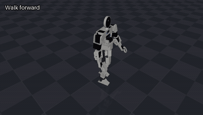
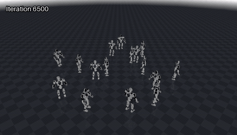
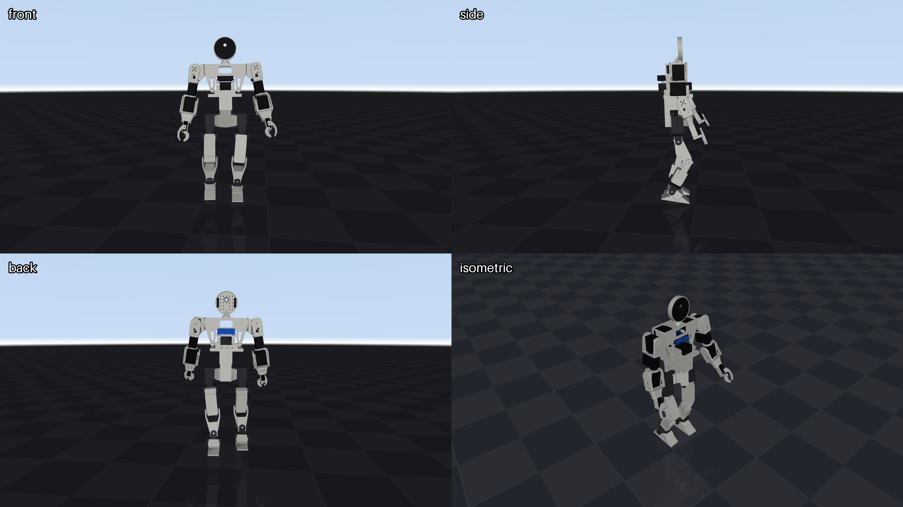

# Chhaya: an open-source, 3D-printed humanoid that learns to walk in simulation

[](training/LICENSE.txt)
[](hardware/LICENSE)

Chhaya is a small humanoid robot, about 54 cm tall, with 20 servo joints, claws for hands and a head built
to carry sensors. Every structural part is 3D printed and the servos themselves form the frame. One neural
network, trained in simulation with reinforcement learning, drives all 20 joints at 50 Hz.

<p align="center">
  
  
</p>
<p align="center">
  
</p>

**[Try it in your browser](https://sca7r.github.io/chhaya-humanoid/)**: tap the floor and the robot walks there. The policy and
the MuJoCo physics run on your device; nothing is installed.

The clips are the trained policy replayed in MuJoCo from Isaac Lab recordings. The robot has not been built yet.

## Highlights

- **Whole-body control.** One policy commands the 12 leg joints and the 8 arm joints together. The arms
  swing opposite to the legs, as a person's do, which halved the falls in testing.
- **Symmetric gait.** The policy is mirror-symmetric by construction and follows a reference gait, so the
  left and right legs move as mirror images.
- **Robust to the real build.** Training randomizes mass, friction, servo response and pushes. The policy
  still walks with the torso 300 g lighter or 150 g heavier than the model.
- **Checked, not assumed.** Every printed part passes automatic overlap, clearance (1 mm or more) and
  strength (safety factor 3 or more) checks. Every policy is tested in a second simulator before export.
- **Plug and play.** The head, claws and face disc each come off with 4 screws, and their hole patterns
  are documented, so your own parts fit.

## Components overview

| Component | Quantity | Notes |
|---|---|---|
| Waveshare ST3215 serial bus servo, 12 V, 30 kg·cm | 20 | 12 in the legs, 8 in the arms, one shared bus |
| MG90S micro servo | 2 | one per claw |
| Raspberry Pi 5 | 1 | on the electronics rack under the chest |
| BNO055 IMU | 1 | I2C |
| Waveshare Bus Servo Adapter (A) | 1 | UART to the servo bus |
| Power distribution PCB | 1 | custom, 55 x 50 mm, design files in [`hardware/electronics/`](hardware/electronics/) |
| 3S LiPo, 11.1 V, 2200 mAh, XT60 | 1 | roughly an hour of walking (estimate) |
| Printed parts, PLA or PETG | 35 | [`hardware/print/`](hardware/print/) |

The full bill of materials, with suppliers and prices, is in [`hardware/bom/`](hardware/bom/). The total is
about $610 with a Raspberry Pi 5. Cheaper options are in [`docs/BUDGET_ELECTRONICS.md`](docs/BUDGET_ELECTRONICS.md).

| Specification | Value |
|---|---|
| Height | about 54 cm |
| Mass | 2.71 kg in the model, with battery and Raspberry Pi 5 |
| Joints | per leg: hip yaw, hip roll, hip pitch, knee, ankle roll, ankle pitch. Per arm: shoulder pitch, shoulder roll, arm yaw, elbow |
| Control | one policy for all 20 joints at 50 Hz. The claws are scripted |
| Walking speed | up to 0.2 m/s forward and backward, 0.15 m/s sideways, turning in place |

## Getting started

1. **Source the hardware.** Order the parts in the [bill of materials](hardware/bom/).
2. **Print the parts.** STL files are in [`hardware/print/`](hardware/print/). Use your printer's default PLA
   profile. Print `ankle_and_hip.stl` tilted 45 degrees with at least 6 walls: it takes the hardest knocks
   in a fall.
3. **Assemble the robot.** Follow the [build guide](hardware/docs/build/), from servo setup to the
   electronics.
4. **Try it in simulation.** No robot or GPU is needed. See [Run in simulation](#run-in-simulation).
5. **Train or fine-tune a policy.** Any recent NVIDIA GPU works, a laptop RTX 3060 included. See
   [Train a walking policy](#train-a-walking-policy).
6. **Deploy to the robot.** Export the policy as an ONNX bundle and run it on the Raspberry Pi. See
   [Status](#status) for what is ready.

## Run in simulation

The simulation stack runs on Linux with Python 3.11. Everything runs from inside `training/`.

```bash
git clone --recurse-submodules https://github.com/sca7r/chhaya-humanoid.git
cd chhaya-humanoid/training
python3.11 -m venv .venv && . .venv/bin/activate
pip install -r requirements.txt pytest tqdm

# bake the reference gait the policy imitates (one time)
(cd robot_motion_reference && python -m gait_studio.bake --style processed/gait_table_style.yaml --out processed/gait_table.npz)

# check the robot model: stands, holds poses, survives a fall
python -m chhaya.physics_check --out /tmp/phys

# run the test suite
pytest tests
```

To watch a trained policy, run the MuJoCo check on an exported bundle. It walks the robot through standing,
walking and control-delay tests and prints a pass or fail report:

```bash
python -m src.mujoco.policy_gate --bundle exported/chhaya_final
```

## Controlling Chhaya

The policy understands one command: how fast to go forward, how fast to go sideways and how fast to
turn. Every way of driving the robot comes down to producing that command, so new input methods do not
need a new policy.

| Input | How it works | Status |
|---|---|---|
| Tap a spot | tap the floor: the robot turns, walks there and stops | available in the browser demo |
| Keyboard and buttons | arrow keys walk and turn, `,` `.` step sideways, `Space` stops; the same on on-screen buttons | available in the browser demo |
| Voice | say "forward", "turn left" or "stop", and the words map to a command | planned |

The browser demo is `web/`: MuJoCo compiled to WebAssembly, the policy in onnxruntime-web and the same servo
model, observation and action map as the MuJoCo check (`web/sim.mjs`). To refresh it with a new policy:

```bash
cd training
python -m src.mujoco.export_web --bundle exported/chhaya_final --trace 300   # writes web/assets/
cd ../web && npm install --no-save @mujoco/mujoco@3.17.0 onnxruntime-web@1.20.1 && node test_sim.mjs .
python3 -m http.server 8000                                                 # open http://localhost:8000
```

The test checks the observations against the Python environment step for step, then lets the policy walk and
reach four tapped spots. Pushing to `main` publishes `web/` (`.github/workflows/pages.yml`).

Commands are limited to the range the policy was trained on (`config/chhaya.yaml`), whatever the input.

## Train a walking policy

Training uses [Isaac Lab 3.0](docs/ISAACLAB3.md) on the Newton physics backend, without Isaac Sim. Install
it as described there, then:

```bash
cd training
# train (the laptop preset fits a 6 GB GPU; --minutes is a wall-clock budget)
python src/isaaclab/train_supermimic.py --model eth --config_path config/chhaya.yaml \
    --num_envs 1024 --preset laptop --minutes 300 --save_every 500

# evaluate a checkpoint on a fixed command (vx m/s, vy m/s, wz rad/s) and record it
python src/isaaclab/train_supermimic.py --model eth --config_path config/chhaya.yaml --num_envs 64 \
    --eval runs/<run>/supermimic_last.pt --command 0.15 0 0 --record videos/walk.npz

# render the recording as a video
MUJOCO_GL=egl python -m src.mujoco.replay_video videos/walk.npz --iso --out videos/walk.mp4

# export the deployment bundle (ONNX) and check it in MuJoCo
python src/isaaclab/train_supermimic.py --model eth --config_path config/chhaya.yaml --num_envs 4 \
    --export runs/<run>/supermimic_last.pt --out_dir exported/chhaya
python -m src.mujoco.policy_gate --bundle exported/chhaya
```

The trainer is [SuperMimic](docs/SUPERMIMIC.md): it learns a model of the robot's dynamics and improves the
policy through imagined rollouts. A standard SAC trainer is also included ([`docs/TRAINING.md`](docs/TRAINING.md)).
To train on a rented GPU, see [`docs/GPU_RUNBOOK.md`](docs/GPU_RUNBOOK.md).

## Project structure

```
chhaya/
├── hardware/                  everything physical
│   ├── cad/                   parametric CAD (chhaya_cad.py) and the checks it must pass
│   ├── print/                 STL files to print
│   ├── bom/                   bill of materials
│   ├── electronics/           power PCB
│   ├── robot_description/     URDF and meshes
│   ├── docs/build/            step-by-step build guide
│   └── regenerate.sh          rebuilds every generated part and reruns the checks
├── training/                  reinforcement learning, run everything from here
│   ├── config/                robot and training configs (chhaya.yaml)
│   ├── envs/                  Isaac Lab and MuJoCo environments, robot models
│   ├── supermimic/            model-based trainer
│   ├── actuator/              servo model fitted to the STS3215
│   ├── src/isaaclab/          training, evaluation, ONNX export
│   ├── src/mujoco/            MuJoCo checks, playback and video rendering
│   └── tests/                 test suite
├── web/                       browser demo (GitHub Pages): tap-to-walk, physics and policy in the browser
└── docs/                      training guides, design decisions, results
```

## Status

| Area | State |
|---|---|
| CAD, print files, URDF | done, all automatic checks pass |
| Simulation model | done, physics checks pass ([`docs/physics/`](docs/physics/)) |
| Walking policy | trained in simulation: walks forward, backward and sideways, turns both ways and recovers from pushes. Tested in MuJoCo before export |
| Turning speed | reaches about 60% of the commanded rate in place. Being improved |
| Hip servo load | about 1.15 N·m RMS while walking, above the servo's continuous rating. Being reduced |
| Physical build | not built yet. The leg and electronics design has been built and walks (see [NOTICE.md](NOTICE.md)) |
| On-robot software | the current runtime drives the 12 leg servos. The 20-joint runtime for the Raspberry Pi 5 is next |

The story of how the walk was trained, with videos of each stage, is in [`docs/JOURNEY.md`](docs/JOURNEY.md).

## Contributing

Issues and pull requests are welcome. Before opening a pull request:

- run the test suite and `python -m chhaya.physics_check` from `training/`;
- change the CAD in `hardware/cad/parametric/chhaya_cad.py` and run `hardware/regenerate.sh`, rather than
  editing the generated URDF, MuJoCo, USD or STL files;
- keep the leg geometry and servo mounting as they are: the trained policies depend on them.

## License

The software in `training/` is released under the [MIT License](training/LICENSE.txt). The hardware in
`hardware/` is released under the [CERN Open Hardware Licence Version 2, Permissive](hardware/LICENSE). Chhaya
builds on open-source work; the credits and notices those licences require are in [NOTICE.md](NOTICE.md).
