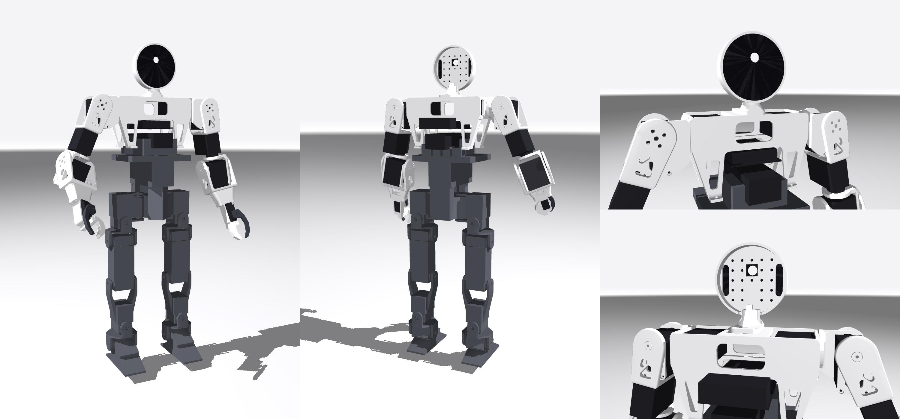

# Chhaya

A small 3D-printed humanoid robot: about 0.52 m tall, 2.4 kg, 20 servo joints, claws for hands
and a head built to carry sensors. It learns to walk with reinforcement learning in simulation.



| | |
|---|---|
| Joints | 20: six per leg (hip yaw, hip roll, hip pitch, knee, ankle roll, ankle pitch), four per arm (shoulder pitch, shoulder roll, arm yaw, elbow) |
| Servos | 20x Feetech/Waveshare STS3215 (12 V bus servos), plus 2 micro servos for the claws |
| Hands | one-servo claws on a standard wrist plate (swap for any tool with 4 screws) |
| Head | halo: a face disc in a hoop, with a drilled plate behind it for a camera and small boards |
| Mass | 2.57 kg (with battery and Raspberry Pi 5) |
| Control | one learned policy drives all 20 joints at 50 Hz; the claws are scripted |
| Structure | 35 printed parts; the servos themselves are the frame |
| Compute | Raspberry Pi 5 or Jetson Orin Nano |

## Status

| | |
|---|---|
| CAD, print files, URDF | done. The chest, head, arms and claws pass the automatic overlap, clearance (≥ 1 mm) and strength (safety factor ≥ 3) checks |
| MuJoCo model and physics checks | done; all pass ([docs/physics/PHYSICS.md](docs/physics/PHYSICS.md)) |
| Training setup | Isaac Lab 3.0 on Newton (no Isaac Sim; any recent NVIDIA GPU). Tested on a CPU: the environment, a short training run and playback work. **Not yet run on a GPU** ([docs/ISAACLAB3.md](docs/ISAACLAB3.md)) |
| Walking policy | not trained yet |
| Budget variant (Chhaya Lite) | simulation set up with RDS3225 / MG996R hobby servos from datasheet estimates; frame not redesigned ([docs/CHHAYA_LITE.md](docs/CHHAYA_LITE.md)) |
| Physical build | not built yet. The legs and electronics are a design that has been built and walks (see Credits); the arms, claws and head are new and unbuilt |
| On-robot software for the arms | not written yet (the runtime drives the 12 leg servos) |

## Layout

```
hardware/     everything physical: CAD, print files, parts lists, electronics, robot description,
              design notes, build guide, and the tools that regenerate and check the generated parts
training/     the reinforcement-learning code: Isaac Lab training, MuJoCo evaluation, servo model
docs/         how training works, the GPU runbook, handoff notes, physics results, budget electronics
```

## Quick start

```bash
git clone --recurse-submodules https://github.com/<you>/chhaya.git
cd chhaya/training
python3.11 -m venv .venv && . .venv/bin/activate
pip install -r requirements.txt pytest tqdm
(cd robot_motion_reference && python -m gait_studio.bake --style processed/gait_table_style.yaml --out processed/gait_table.npz)
pytest tests/test_arm_motion.py tests/test_chhaya_mujoco.py    # 11 pass, no GPU needed
python -m chhaya.physics_check --out /tmp/phys                 # stands, holds poses, survives a fall
```

| I want to... | Go to |
|---|---|
| See what to buy and what it costs | [`hardware/bom/`](hardware/bom/), cheaper options in [`docs/BUDGET_ELECTRONICS.md`](docs/BUDGET_ELECTRONICS.md) |
| Print the parts | [`hardware/print/`](hardware/print/) |
| Build it | [`hardware/docs/build/`](hardware/docs/build/) |
| Understand or change the mechanical design | [`hardware/docs/design.md`](hardware/docs/design.md) |
| Simulate it | [`hardware/robot_description/urdf/chhaya.urdf`](hardware/robot_description/), `training/envs/assets/robotV2/chhaya.xml` (MuJoCo), `chhaya.usd` (Isaac Lab) |
| Train the walking policy | [`docs/TRAINING.md`](docs/TRAINING.md), [`docs/GPU_RUNBOOK.md`](docs/GPU_RUNBOOK.md) |
| Pick up the project where it stands | [`docs/HANDOFF.md`](docs/HANDOFF.md), [`docs/READINESS.md`](docs/READINESS.md) |

## Design in brief

- **The servos are the structure.** Printed parts are thin plates and forks screwed to the servos'
  own mounting holes. No cosmetic covers.
- **Plug and play.** The head (4 screws on the neck flange), the claws (4 screws on the wrist
  plate), the face disc and every bracket come off without disturbing their neighbours. The hole
  patterns are documented, so your own parts fit.
- **Checked, not assumed.** Clearance is measured through every arm joint's full range. Strength
  is calculated on real cross-sections cut from the CAD, against a fall onto a hand, the head and
  the chest. Changing a dimension reruns all of it (`hardware/regenerate.sh`).
- **What it can do:** walk, gesture, hold light objects (the claws grip with about 5 N). It is not
  strong enough for housework.

## Credits and licence

`training/` is MIT and `hardware/` is CERN-OHL-P-2.0; new work follows the licence of the directory
it is in. Parts of Chhaya are derived from open-source work; the credits, source commits and the list
of changes that those licences require are in [NOTICE.md](NOTICE.md).
