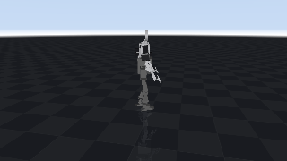
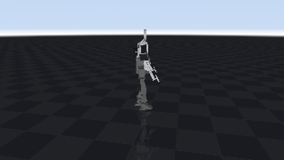

# Chhaya: the training journey

How Chhaya learned to walk, in videos. Each clip shows one robot asked to walk forward at 0.15 m/s for
20 s. The motion is recorded in the training simulator (Isaac Lab 3.0, Newton) and replayed in MuJoCo for
the picture; the replay is kinematic, so it shows exactly what the policy did. Full-size MP4s sit next to
the GIFs in `docs/journey/`.

Recorded with `train_supermimic.py --eval <checkpoint> --command 0.15 0 0 --record x.npz`, then
`python -m src.mujoco.replay_video x.npz --out x.mp4 --gif x.gif` (from `training/`).

Numbers: 64 robots, 20 s, same command. "Speed error" is the mean gap between commanded and actual
velocity (standing still scores 0.15).

## 1. SuperMimic v1: learned reward (2026-11-19, 2 h on an RTX 3060 laptop)

The first GPU run of our SuperMimic reimplementation, where the world model also learned the reward.
The robot survives longer as training goes on, but it wobbles and spins instead of following the
command: speed error 0.124 m/s, 0.44 falls per robot in 20 s. Long episodes came from not falling, not
from walking.

## 2. SuperMimic, ETH style: analytic reward (2026-11-19, 3 h)

Rewritten after the official SuperMimic code and ETH's walking port: the world model learns only the
dynamics and the reward is computed from the predicted state (`supermimic/eth.py`). The robot walks
forward: 0.106 m/s for 0.15 commanded, speed error 0.079 m/s, 0.08 falls per robot in 20 s.

What was still wrong: the env's own reward showed the feet rolling onto their edges (`foot_flat` about
−2.4 per second), a stance that tips the real robot over. The analytic reward had no foot-flat term.

## 3. Fine-tune with flat feet (in progress)

Foot-flat terms added to the analytic reward (same weights as the env), the world-model fit made
5x faster (it no longer computes the reward it never uses), and training continued from step 2 for 8 h.

**After 1 h (iteration 3000):**

Faster and closer to the command: 0.143 m/s for 0.15 commanded, speed error 0.067 m/s; sole roll
penalty 5x smaller than in step 2. Falls went up for now (0.22 per robot in 20 s, from 0.08), as
expected right after a reward change.
