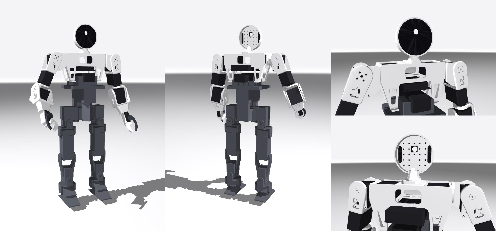

# Chhaya hardware

**Open hardware for a small 20-servo humanoid that learns to walk in simulation.**
CAD, print files, bill of materials, power PCB, robot description (URDF) and build guide.

<p align="center">
  
</p>

The picture is a render of the model: Chhaya has not been built yet. Credits and licences:
[`../NOTICE.md`](../NOTICE.md).

---

## Specs

| | |
|---|---|
| Height | About 54 cm standing |
| Mass | 2.57 kg in the model (with battery and Raspberry Pi 5) |
| Degrees of freedom | 20: per leg hip yaw, hip roll, hip pitch, knee, ankle roll, ankle pitch; per arm shoulder pitch, shoulder roll, arm yaw, elbow |
| Actuators | 20× Waveshare ST3215 serial bus servos (12 V, 30 kg·cm), one shared bus at 1 Mbaud; 2 micro servos for the claws |
| Hands | One-servo claws on a standard wrist plate |
| Head | Halo head with a drilled plate for a camera and small boards |
| Compute | Raspberry Pi 5 on the electronics rack under the chest, 50 Hz control loop. A Jetson Orin Nano does not fit (see [`docs/design.md`](docs/design.md#electronics)) |
| IMU | BNO055 on I2C |
| Power | 3S LiPo (11.1 V, 2200 mAh) through a custom power PCB |
| Structure | 35 printed parts, PLA or PETG |
| Cost | ≈ $610 with a Raspberry Pi 5 (2 GB); ≈ $910 with the Jetson. Cheaper options in [`../docs/BUDGET_ELECTRONICS.md`](../docs/BUDGET_ELECTRONICS.md) |

---

## Where to start

| I want to... | Go to |
|---|---|
| See what to buy and what it costs | [`bom/`](bom/) |
| Print the parts | [`print/`](print/) |
| Understand or modify the design | [`docs/design.md`](docs/design.md), [`cad/`](cad/) (STEP for any CAD tool; parametric source for the chest, head and arms) |
| Order or build the power board | [`electronics/power_pcb/`](electronics/power_pcb/) |
| Wire it | [`electronics/wiring/`](electronics/wiring/) |
| Build it | [`docs/build/`](docs/build/) |
| Simulate it | [`robot_description/`](robot_description/) (URDF + meshes) |

The Fusion 360 archive of the legs and the PCB gerbers are downloads on the release page of the
leg platform's source repository (linked in [`../NOTICE.md`](../NOTICE.md)).

---

## Cost

| Part | Cost (USD) |
|---|---|
| 20× Waveshare ST3215 servos | 439.80 |
| 2× micro servos for the claws (estimate) | 6.00 |
| BNO055 IMU | 17.00 |
| Power PCB | 25.00 |
| Waveshare Bus Servo Adapter (A) | 4.99 |
| 3S 2200 mAh LiPo | 20.00 |
| **Robot without a computer** | **512.79** |

| With... | Total (USD) |
|---|---|
| Raspberry Pi 5, 2 GB + 12 V → 5 V USB-C step-down | **≈ 610** |
| Raspberry Pi 5, 4 GB + 12 V → 5 V USB-C step-down | **≈ 643** |
| NVIDIA Jetson Orin Nano Super | **≈ 912** |

The policy is a small network that runs on the CPU, so a **Raspberry Pi 5 can replace the Jetson**.
The Pi setup (power, wiring, two config changes) is in
[`bom/README.md`](bom/README.md#raspberry-pi-instead-of-the-jetson) and hasn't been tested on a robot yet.
The legs alone (12 servos, no arms) come to ≈ $331 without a computer.

Prices were checked in October 2026; details and links are in [`bom/`](bom/). Not in the prices: the microSD
card, about 0.7 kg of filament, small parts (wires, switch, leads, fuses) and the M2/M3 screws for the arms. Tools: a 3D printer, a soldering
iron and a LiPo balance charger.

---

## Repository layout

```
cad/
├── step/              One STEP per printed part; the legs-and-torso assembly (zipped)
├── fusion/            Fusion 360 archive of the legs (download from the release)
└── parametric/        CadQuery source of the chest, head, arms and claws + check results
print/stl/             One STL per printed part, with print notes in print/README.md
robot_description/     URDF + meshes: chhaya.urdf is the whole robot (ROS package "Robot_description")
electronics/
├── Schematic_RobotPCB.pdf
├── power_pcb/         Power PCB: EasyEDA source, gerbers, BOM, pick-and-place, render
└── wiring/            Servo ID map, Jetson pinout, IMU mounting
bom/                   Purchased parts and printed parts (CSV)
docs/design.md         Mechanical design: interfaces, strength, clearances, kinematics
docs/build/            Build guide
tools/, regenerate.sh  Rebuild and check everything generated from the parametric CAD
media/                 Photos and renders
```

The training code reads the robot description from here through `training/robot_hardware`.

---

## Credits

<p>
  
</p>

- The legs, hips, torso and power electronics derive from open-source work by Pablo Gomez Martinez
  ([`../NOTICE.md`](../NOTICE.md)).
- The power PCB was fabricated and assembled by [PCBWay](https://www.pcbway.com/), who sponsored this board for the leg platform's source project.
- The servo model used in simulation builds on Rhoban's [BAM](https://github.com/Rhoban/bam).
- The URDF was exported from Fusion 360 with [fusion2urdf](https://github.com/syuntoku14/fusion2urdf)
  (MIT, see [`robot_description/LICENSE-fusion2urdf`](robot_description/LICENSE-fusion2urdf)).

---

## License

The hardware design (CAD, print files, PCB, robot description, documentation) is licensed under the
[CERN Open Hardware Licence Version 2 - Permissive](LICENSE) (CERN-OHL-P-2.0).
The exporter template files in `robot_description/` keep their own MIT licence; the robot design itself is
covered by CERN-OHL-P. The software repos are MIT.
