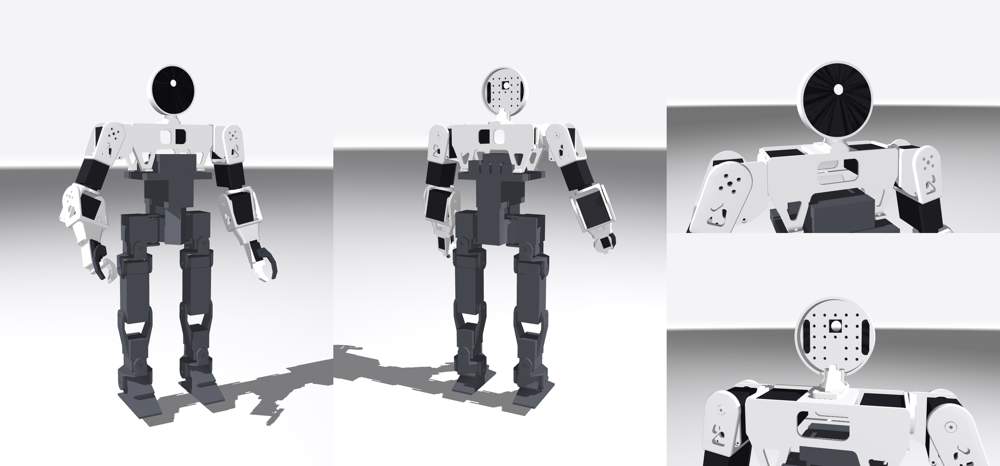

# Mechanical design

How Chhaya's printed structure is designed and checked. The legs, hips and torso are Fusion 360
parts (`cad/step/`, `cad/fusion/`); the chest, head, arms and claws are parametric CadQuery
(`cad/parametric/chhaya_cad.py`), which is what makes the automatic checks below possible. Both
follow one rule: **the servos are the structure**, and printed parts are plates and forks screwed
to the servos' own holes.



| | |
|---|---|
| New joints | 8: `{l,r}_shoulder_pitch`, `{l,r}_shoulder_roll`, `{l,r}_arm_yaw`, `{l,r}_elbow` |
| Servos | 8x STS3215 12 V (same as the legs, same bus, same BAM model) |
| Mass of chest, head and arms | 731 g (480 g of it is the 8 STS3215s, 27 g the two claw micro servos) |
| Robot mass | 2.392 kg (legs-only robot: 1.661 kg) |
| Height | the head hoop top is ~0.52 m above the floor when standing |
| Printed parts | 20 (9 left/right pairs + chest + head), plus the face disc; ~190 g PLA/PETG |
| Physics | passes every check in `../../docs/physics/PHYSICS.md`: stands, holds worst arm poses at under 7 % of stall, arms moving never tip it, no arm/leg contact within gait ranges, stable at half timestep and with backlash |
| Checks | every part is a single valid solid and a watertight STL; zero overlap between parts over 153 poses (each joint through its full range plus 80 random combinations); every moving part clears what it swings past by ≥ 1.0 mm over the whole range; MJCF and URDF compile in MuJoCo 3.2.7 (the repo's pin) and 4.0 |


## Chest, head, arms and claws

**Look:** rounded and open. Round-eared forks with rounded outer edges and triangulated windows, a
thin hollow forearm shell, an open chest (servos and wiring visible and reachable), and a halo head.
No cosmetic covers: every gram of plastic is structure.

**Plug and play.** Every module has one standard interface, so it can be swapped without touching
its neighbours:

| Module | Interface | Swap with |
|---|---|---|
| Head | neck flange: 4x M3 at (−14, ±9) and (+7, ±9) mm from `NECK`, into the chest saddle | any head with that flange |
| Face disc (`head_visor`) | press fit in the hoop (Ø 67.2) | printed disc, tinted acrylic, a display |
| Sensors in the head | 10 mm grid of Ø2.7 holes (M2.5) on the plate behind the face, camera window 12 x 12 | any board |
| Claw (`claw_base` + `claw_jaw`) | wrist plate 16 x 31 mm, 4x M3 at (±4.5, ±12) mm, screwed in from below (`WRIST_*` in the CAD) | any tool with that plate |
| Claw servo | MG90S-class micro servo, 2 tab screws | — |
| Every bracket | only its own servo's M2 face holes / horn screws | reprint one part |
| Chest | 4x M3 through the torso shelf | — |

**The claw.** One micro servo per hand (not simulated as a joint: it is fixed mass on the forearm, so
the policy and the training code don't know about it). The fixed jaw is part of `claw_base`; the
moving jaw screws to the servo horn and opens ~45°. About 5 N at the tips. The pocket is sized for
an MG90S (22.8 x 12.2 mm body): **measure your servo before printing** (`GR_L`, `GR_W`).

Same design language as the legs (thigh / calf / ankle_and_hip):

- **The servos are the structure.** Printed parts are flat 3–4 mm plates that screw to the
  servos' own M2 face holes, the way the leg brackets do. The hole pattern (4x M2 per face,
  24.5 x 20.5 mm, at 8.2 / 32.7 mm from the shaft) was measured from the screw positions in the
  reference assembly STEP.
- **Dual-support forks** at the shoulder roll and the elbow. One ear bolts to the horn and the
  other turns on a printed idler stub screwed to the servo's back face (0.3 mm running
  clearance in the bore, 1 mm axial gap to the cap, held by an M3 screw and washer). The load goes into both sides of the servo rather
  than cantilevering off the horn.
- **Modular.** The upper-arm fork and the forearm fork are the same geometry. The roll and
  elbow idler caps are the same part.
- **Rounded, filleted joints.** 6 mm concave fillets wherever two plates meet, rounded ears,
  and pocketed cut-outs with at least 4 mm rims. There are no sharp inside corners to start
  cracks.

**Strength.** `tools/strength_check.py` cuts the real CAD at each critical section, takes the exact
area and second moment of area, applies the design loads and **fails the build below a safety
factor of 3**. Design loads: joint torque 4.9 N·m (the peak in the simulated fall onto an arm;
servo stall is 2.94 N·m), 45 N on a claw tip in any direction (about twice the robot's weight on one
hand), 50 N on top of the head, and 75 N on the whole upper body (its 0.75 kg at 10 g). Printed
PLA: 50 MPa along the layers, 25 MPa across them; the print orientations in the table further
down are the ones this assumes. Current result (`cad/parametric/checks/strength.json`), lowest factor
3.4:

| Section | Load | Stress | Allowable | Safety factor |
|---|---|---|---|---|
| upper-arm fork, horn ear at the window | shoulder-roll torque 4.9 N*m | 8.4 MPa | 50.0 MPa | 6.0 |
| forearm fork, horn ear at the window | elbow torque 4.9 N*m | 8.4 MPa | 50.0 MPa | 6.0 |
| upper-arm fork, both ears, sideways | 4.9 N*m about Y | 1.2 MPa | 50.0 MPa | 42.4 |
| forearm fork, both ears, sideways | 45 N sideways on the claw tip | 1.2 MPa | 50.0 MPa | 42.3 |
| forearm shell, mid-height, sideways | 45 N sideways on the claw tip | 2.6 MPa | 50.0 MPa | 18.9 |
| forearm shell, mid-height, fore-aft | 45 N fore-aft on the claw tip | 7.2 MPa | 50.0 MPa | 7.0 |
| claw housing walls, sideways | 45 N sideways on the claw tip | 5.3 MPa | 50.0 MPa | 9.4 |
| claw housing walls, fore-aft | 45 N fore-aft on the claw tip | 13.0 MPa | 50.0 MPa | 3.8 |
| fixed jaw, root, in the jaw plane | 45 N on the jaw tip | 10.1 MPa | 50.0 MPa | 5.0 |
| fixed jaw, root, across the jaw plane | 45 N on the jaw tip | 13.5 MPa | 50.0 MPa | 3.7 |
| fixed jaw, middle, in the jaw plane | 45 N on the jaw tip | 5.9 MPa | 50.0 MPa | 8.4 |
| fixed jaw, middle, across the jaw plane | 45 N on the jaw tip | 8.1 MPa | 50.0 MPa | 6.2 |
| moving jaw, near the hub | 0.30 N*m (its micro servo stalls / strips first) | 8.1 MPa | 50.0 MPa | 6.1 |
| wrist screws (4x M3), fore-aft | 45 N on the claw tip -> 113 N per screw | 113.0 MPa | 509.82158281536846 MPa | 4.5 |
| wrist screws (4x M3), sideways | 45 N on the claw tip -> 55 N per screw | 54.5 MPa | 509.82158281536846 MPa | 9.4 |
| shoulder bracket, plate beside the pad | shoulder-roll torque 4.9 N*m | 4.5 MPa | 50.0 MPa | 11.2 |
| neck above the flange, fore-aft hit | 50 N on top of the hoop | 2.6 MPa | 25.0 MPa | 9.7 |
| neck above the flange, side hit | 50 N on top of the hoop | 3.7 MPa | 25.0 MPa | 6.7 |
| chest legs, front plate, just above the feet, fore-aft | 75 N fore-aft on the upper body | 6.2 MPa | 25.0 MPa | 4.0 |
| chest legs, back plate, just above the feet, fore-aft | 75 N fore-aft on the upper body | 6.2 MPa | 25.0 MPa | 4.0 |
| chest legs, front plate, mid-height, fore-aft | 75 N fore-aft on the upper body | 6.3 MPa | 25.0 MPa | 3.9 |
| chest legs, back plate, mid-height, fore-aft | 75 N fore-aft on the upper body | 6.3 MPa | 25.0 MPa | 3.9 |
| chest legs, all four, sideways | 75 N sideways on the upper body | 0.3 MPa | 25.0 MPa | 83.1 |
| horn screws (4x M3): bearing on the 4 mm ear | 4.9 N*m -> 175 N per screw | 14.6 MPa | 50.0 MPa | 3.4 |
| face screws (4x M2): bearing on the 3 mm plate | 4.9 N*m -> 77 N per screw | 12.8 MPa | 50.0 MPa | 3.9 |
| idler stub (dia 8), bending at the collar | half of 45 N at the ear | 1.8 MPa | 25.0 MPa | 14.0 |

What the check changed in the design:
- **Fixed claw finger:** it was 5 x 6 mm (factor 1.2 against a hit on its tip); now 7 x 10 mm at the root.
- **Chest legs:** flat 2.5 mm legs bend the weak way when the robot falls forward or back
  (factor 1.4). Each leg now has a 6 mm rib along its outer edge (an L-section), which is lighter
  than the old 3 mm legs and 2.7 times stronger.
- **Wrist:** 4 screws instead of 2, so a fore-aft hit on the claw can't lever the plate off.
- **Where there was far more margin than needed, material came out:** forearm shell wall 1.8 → 1.5 mm,
  the forearm bridge is open inside the shell (it doubles as the wire path), head hoop 3 → 2.4 mm,
  hollow neck.

It is beam theory on measured sections, not a finite-element analysis, and the fall loads are
estimates: treat the factors as margins, not guarantees. The moving jaw is protected by its
micro servo, which gives way first; in a hard fall the STS3215 gears back-drive before a bracket
breaks.

**Design loads.** Every bracket is sized for the servo's full stall torque (2.94 N·m) plus a
fall onto the arm, not just the arm's weight:

| Spot | Load at stall | Check |
|---|---|---|
| Horn screws (4x M3 on a 14 mm circle) | ~105 N each | 4 mm ears/pads keep PLA bearing stress under 10 MPa |
| Face screws (4x M2) | ~60 N each in shear | at least 2.4 mm of plastic around every hole; heads counterbored 1.6 mm so the moving ear clears them |
| Fork | bending of the ears | bridge is 39 mm from the axis, so the lever arm is short; the second ear halves the load per ear |
| Idler stub (Ø8, 6.3 mm long) | half the joint load | filleted collar spreads it into the cap and 4 screws |
| Neck | robot falls on its head | round column into the sensor plate and hoop + a rib leaning back over the flange, bolted with 4x M3 |

**Clearances (for real prints, not just CAD).** Every part that moves past another part or a
servo clears it by at least **1.0 mm** over the joint's whole range, enough for normal FDM
tolerance and elephant's foot. `tools/check_interference.py` measures this on every build and
fails below 1 mm (`cad/parametric/checks/clearance.json`):

| Moving part, passing... | Min gap | Where it is set |
|---|---|---|
| shoulder bracket → chest cheek plate | 1.00 mm | `PLATE` = 3.0 (case top → horn face is 4 mm) |
| upper-arm fork → shoulder-bracket face plate | 1.00 mm | `PLATE`, plus the plate clipped to `PLATE_CLIP_R` = 37.5 mm around the roll axis and a 1.5 mm inside fillet where the horn ear meets the bridge (`HORN_CORNER_R`) |
| forearm fork → elbow-link face plate | 1.00 mm | same as above, around the elbow axis |
| forks → servo cases | 1.8 mm | `FORK_D` = 39 vs case corners at 37.2 mm |
| horn pads → servo case under the horn | 4.0 mm | the horn's own height |
| idler ear → cap / collar | 1.0 mm axial | `IDLER_GAP`; the stub bore itself is a 0.3 mm running fit |
| claw jaw → claw base / its micro servo | 1.95 mm / 1.2 mm, swept from 1 mm short of closed to 60° open | `gripper_geom()` |

Parts screwed to a horn seat flush on it; plates screwed to a case face sit flush on it.

## Arm kinematics and limits

Both arms use the same sign conventions (the right arm's roll and yaw axes are mirrored):

| Joint | Axis (left) | Range [rad] | Positive direction |
|---|---|---|---|
| shoulder_pitch | +Y | −3.0 … +1.0 | arm backward (negative = forward/up) |
| shoulder_roll | +X | +0.05 … +2.6 | arm out to the side (the arms rest at 0.12, slightly away from the legs) |
| arm_yaw | +Z | −1.57 … +1.57 | upper arm rotates outward |
| elbow | +Y | −2.0 … +0.1 | negative = flex |

The joint origins are in `cad/parametric/chhaya_cad.py` (`SHOULDER`, `ROLL`, `YAW`, `ELBOW`). The arms
hang outside the legs: the legs reach |y| = 77 mm at the thighs, and the hand centre line is
at |y| = 95 mm.

## Legs

Six joints per leg (hip yaw, hip roll, hip pitch, knee, ankle roll, ankle pitch), unchanged from
the Sir Servington design this robot derives from. The walking policy, the gait references and the
servo model all depend on the legs' joint positions, servo mounting and foot soles, so those are
fixed. The part most likely to break in a fall is `ankle_and_hip.stl`: see the print notes.

## Changing the design

Edit the named constants at the top of `cad/parametric/chhaya_cad.py`, then run:

```bash
pip install cadquery trimesh mujoco python-fcl usd-core pillow
./regenerate.sh          # from hardware/
```

It rewrites, in order: the STEP files (`cad/step/bodies/`), the print files (`print/stl/`), the
robot description (`robot_description/urdf/chhaya.urdf` + meshes), the MuJoCo model
(`training/envs/assets/robotV2/chhaya.xml`), the Isaac Lab model (`chhaya.usd`) and the pictures
(`media/chhaya/`). It stops if any part overlaps another, any moving gap is under 1 mm or any
safety factor is under 3. Results are in `cad/parametric/checks/` (`parts.json`,
`interference.json`, `clearance.json`, `strength.json`). Then, from `training/`:
`pytest tests/test_chhaya_mujoco.py` and `python -m chhaya.physics_check`.

| Tool (`tools/`) | What it does |
|---|---|
| `build_description.py` | CAD → meshes, URDF, MuJoCo model, mass budget |
| `check_interference.py` | sweeps every joint with exact mesh-vs-mesh tests: overlap, minimum clearance, claw sweep |
| `strength_check.py` | stress and safety factor at each critical section, from the CAD |
| `validate_model.py` | compiles the MuJoCo model and the URDF, prints the joint table |
| `build_usd.py` | Isaac Lab USD with plain usd-core (no Isaac Sim needed) |
| `render_robot.py` | pictures from the generated model |
