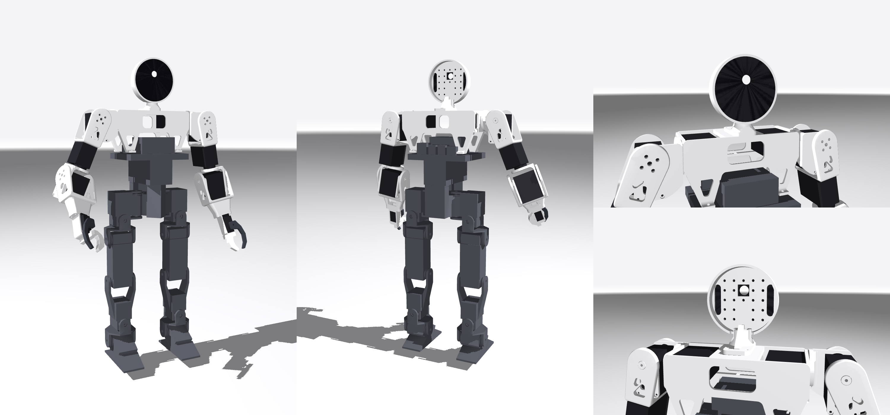

# Chhaya's upper body

Two 4-DOF arms with one-servo claws, an open chest that bolts onto the existing torso shelf,
and a halo head (dark face disc in a hoop) with a drilled sensor plate. Designed for **simulation first** (STS3215 on every
arm joint, so the validated BAM servo model covers all 20 joints and one policy can drive the
whole robot).

| | |
|---|---|
| New joints | 8: `{l,r}_shoulder_pitch`, `{l,r}_shoulder_roll`, `{l,r}_arm_yaw`, `{l,r}_elbow` |
| Servos | 8x STS3215 12 V (same as the legs, same bus, same BAM model) |
| Upper-body mass | 731 g (480 g of it is the 8 STS3215s, 27 g the two claw micro servos) |
| Robot mass | 2.392 kg (legs-only robot: 1.661 kg) |
| Height | the head hoop top is ~0.52 m above the floor when standing |
| Printed parts | 20 (9 left/right pairs + chest + head), plus the face disc; ~190 g PLA/PETG |
| Physics | passes every check in `physics_report/PHYSICS.md`: stands, holds worst arm poses at under 7 % of stall, arms moving never tip it, no arm/leg contact within gait ranges, stable at half timestep and with backlash |
| Checks | every part is a single valid solid and a watertight STL; zero overlap between parts over 153 poses (each joint through its full range plus 80 random combinations); every moving part clears what it swings past by ≥ 1.0 mm over the whole range; MJCF and URDF compile in MuJoCo 3.2.7 (the repo's pin) and 4.0 |



## Design

**Look:** rounded and open. Round-eared forks with rounded outer edges and triangulated windows, a
thin hollow forearm shell, an open chest (servos and wiring visible and reachable), and a halo head.
No cosmetic covers: every gram of plastic is structure.

**Plug and play.** Every module has one standard interface, so it can be swapped without touching
its neighbours:

| Module | Interface | Swap with |
|---|---|---|
| Head | neck flange: 4x M3 at (−14, ±9) and (+7, ±9) mm from `NECK`, into the chest saddle | any head with that flange |
| Face disc (`head_visor`) | press fit in the hoop (Ø 67.2) | printed disc, tinted acrylic, a display |
| Sensors in the head | 10 mm grid of Ø2.7 holes (M2.5) on the plate behind the face, camera window 12 x 12 | any board |
| Claw (`claw_base` + `claw_jaw`) | wrist plate 16 x 31 mm, 4x M3 at (±4.5, ±12) mm, screwed in from below (`WRIST_*` in the CAD) | any tool with that plate |
| Claw servo | MG90S-class micro servo, 2 tab screws | — |
| Every bracket | only its own servo's M2 face holes / horn screws | reprint one part |
| Chest | 4x M3 through the torso shelf | — |

**The claw.** One micro servo per hand (not simulated as a joint: it is fixed mass on the forearm, so
the policy and the training code don't know about it). The fixed jaw is part of `claw_base`; the
moving jaw screws to the servo horn and opens ~45°. About 5 N at the tips. The pocket is sized for
an MG90S (22.8 x 12.2 mm body): **measure your servo before printing** (`GR_L`, `GR_W`).

Same design language as the legs (thigh / calf / hip_and_ankle):

- **The servos are the structure.** Printed parts are flat 3–4 mm plates that screw to the
  servos' own M2 face holes, the way the leg brackets do. The hole pattern (4x M2 per face,
  24.5 x 20.5 mm, at 8.2 / 32.7 mm from the shaft) was measured from the screw positions in the
  reference assembly STEP.
- **Dual-support forks** at the shoulder roll and the elbow. One ear bolts to the horn and the
  other turns on a printed idler stub screwed to the servo's back face (0.3 mm running
  clearance in the bore, 1 mm axial gap to the cap, held by an M3 screw and washer). The load goes into both sides of the servo rather
  than cantilevering off the horn.
- **Modular.** The upper-arm fork and the forearm fork are the same geometry. The roll and
  elbow idler caps are the same part.
- **Rounded, filleted joints.** 6 mm concave fillets wherever two plates meet, rounded ears,
  and pocketed cut-outs with at least 4 mm rims. There are no sharp inside corners to start
  cracks.

**Strength.** `tools/strength_check.py` cuts the real CAD at each critical section, takes the exact
area and second moment of area, applies the design loads and **fails the build below a safety
factor of 3**. Design loads: joint torque 4.9 N·m (the peak in the simulated fall onto an arm;
servo stall is 2.94 N·m), 45 N on a claw tip in any direction (about twice the robot's weight on one
hand), 50 N on top of the head, and 75 N on the whole upper body (its 0.75 kg at 10 g). Printed
PLA: 50 MPa along the layers, 25 MPa across them; the print orientations in the table further
down are the ones this assumes. Current result (`cad/out/sts3215/strength.json`), lowest factor
3.4:

| Section | Load | Stress | Allowable | Safety factor |
|---|---|---|---|---|
| upper-arm fork, horn ear at the window | shoulder-roll torque 4.9 N*m | 8.4 MPa | 50.0 MPa | 6.0 |
| forearm fork, horn ear at the window | elbow torque 4.9 N*m | 8.4 MPa | 50.0 MPa | 6.0 |
| upper-arm fork, both ears, sideways | 4.9 N*m about Y | 1.2 MPa | 50.0 MPa | 42.4 |
| forearm fork, both ears, sideways | 45 N sideways on the claw tip | 1.2 MPa | 50.0 MPa | 42.3 |
| forearm shell, mid-height, sideways | 45 N sideways on the claw tip | 2.6 MPa | 50.0 MPa | 18.9 |
| forearm shell, mid-height, fore-aft | 45 N fore-aft on the claw tip | 7.2 MPa | 50.0 MPa | 7.0 |
| claw housing walls, sideways | 45 N sideways on the claw tip | 5.3 MPa | 50.0 MPa | 9.4 |
| claw housing walls, fore-aft | 45 N fore-aft on the claw tip | 13.0 MPa | 50.0 MPa | 3.8 |
| fixed jaw, root, in the jaw plane | 45 N on the jaw tip | 10.1 MPa | 50.0 MPa | 5.0 |
| fixed jaw, root, across the jaw plane | 45 N on the jaw tip | 13.5 MPa | 50.0 MPa | 3.7 |
| fixed jaw, middle, in the jaw plane | 45 N on the jaw tip | 5.9 MPa | 50.0 MPa | 8.4 |
| fixed jaw, middle, across the jaw plane | 45 N on the jaw tip | 8.1 MPa | 50.0 MPa | 6.2 |
| moving jaw, near the hub | 0.30 N*m (its micro servo stalls / strips first) | 8.1 MPa | 50.0 MPa | 6.1 |
| wrist screws (4x M3), fore-aft | 45 N on the claw tip -> 113 N per screw | 113.0 MPa | 509.82158281536846 MPa | 4.5 |
| wrist screws (4x M3), sideways | 45 N on the claw tip -> 55 N per screw | 54.5 MPa | 509.82158281536846 MPa | 9.4 |
| shoulder bracket, plate beside the pad | shoulder-roll torque 4.9 N*m | 4.5 MPa | 50.0 MPa | 11.2 |
| neck above the flange, fore-aft hit | 50 N on top of the hoop | 2.6 MPa | 25.0 MPa | 9.7 |
| neck above the flange, side hit | 50 N on top of the hoop | 3.7 MPa | 25.0 MPa | 6.7 |
| chest legs, front plate, just above the feet, fore-aft | 75 N fore-aft on the upper body | 6.2 MPa | 25.0 MPa | 4.0 |
| chest legs, back plate, just above the feet, fore-aft | 75 N fore-aft on the upper body | 6.2 MPa | 25.0 MPa | 4.0 |
| chest legs, front plate, mid-height, fore-aft | 75 N fore-aft on the upper body | 6.3 MPa | 25.0 MPa | 3.9 |
| chest legs, back plate, mid-height, fore-aft | 75 N fore-aft on the upper body | 6.3 MPa | 25.0 MPa | 3.9 |
| chest legs, all four, sideways | 75 N sideways on the upper body | 0.3 MPa | 25.0 MPa | 83.1 |
| horn screws (4x M3): bearing on the 4 mm ear | 4.9 N*m -> 175 N per screw | 14.6 MPa | 50.0 MPa | 3.4 |
| face screws (4x M2): bearing on the 3 mm plate | 4.9 N*m -> 77 N per screw | 12.8 MPa | 50.0 MPa | 3.9 |
| idler stub (dia 8), bending at the collar | half of 45 N at the ear | 1.8 MPa | 25.0 MPa | 14.0 |

What the check changed in the design:
- **Fixed claw finger:** it was 5 x 6 mm (factor 1.2 against a hit on its tip); now 7 x 10 mm at the root.
- **Chest legs:** flat 2.5 mm legs bend the weak way when the robot falls forward or back
  (factor 1.4). Each leg now has a 6 mm rib along its outer edge (an L-section), which is lighter
  than the old 3 mm legs and 2.7 times stronger.
- **Wrist:** 4 screws instead of 2, so a fore-aft hit on the claw can't lever the plate off.
- **Where there was far more margin than needed, material came out:** forearm shell wall 1.8 → 1.5 mm,
  the forearm bridge is open inside the shell (it doubles as the wire path), head hoop 3 → 2.4 mm,
  hollow neck.

It is beam theory on measured sections, not a finite-element analysis, and the fall loads are
estimates: treat the factors as margins, not guarantees. The moving jaw is protected by its
micro servo, which gives way first; in a hard fall the STS3215 gears back-drive before a bracket
breaks.

**Design loads.** Every bracket is sized for the servo's full stall torque (2.94 N·m) plus a
fall onto the arm, not just the arm's weight:

| Spot | Load at stall | Check |
|---|---|---|
| Horn screws (4x M3 on a 14 mm circle) | ~105 N each | 4 mm ears/pads keep PLA bearing stress under 10 MPa |
| Face screws (4x M2) | ~60 N each in shear | at least 2.4 mm of plastic around every hole; heads counterbored 1.6 mm so the moving ear clears them |
| Fork | bending of the ears | bridge is 39 mm from the axis, so the lever arm is short; the second ear halves the load per ear |
| Idler stub (Ø8, 6.3 mm long) | half the joint load | filleted collar spreads it into the cap and 4 screws |
| Neck | robot falls on its head | round column into the sensor plate and hoop + a rib leaning back over the flange, bolted with 4x M3 |

**Clearances (for real prints, not just CAD).** Every part that moves past another part or a
servo clears it by at least **1.0 mm** over the joint's whole range, enough for normal FDM
tolerance and elephant's foot. `tools/check_interference.py` measures this on every build and
fails below 1 mm (`cad/out/sts3215/clearance.json`):

| Moving part, passing... | Min gap | Where it is set |
|---|---|---|
| shoulder bracket → chest cheek plate | 1.00 mm | `PLATE` = 3.0 (case top → horn face is 4 mm) |
| upper-arm fork → shoulder-bracket face plate | 1.00 mm | `PLATE`, plus the plate clipped to `PLATE_CLIP_R` = 37.5 mm around the roll axis and a 1.5 mm inside fillet where the horn ear meets the bridge (`HORN_CORNER_R`) |
| forearm fork → elbow-link face plate | 1.00 mm | same as above, around the elbow axis |
| forks → servo cases | 1.8 mm | `FORK_D` = 39 vs case corners at 37.2 mm |
| horn pads → servo case under the horn | 4.0 mm | the horn's own height |
| idler ear → cap / collar | 1.0 mm axial | `IDLER_GAP`; the stub bore itself is a 0.3 mm running fit |
| claw jaw → claw base / its micro servo | 1.95 mm / 1.2 mm, swept from 1 mm short of closed to 60° open | `gripper_geom()` |

Parts screwed to a horn seat flush on it; plates screwed to a case face sit flush on it.

## Files

```
cad/upper_body.py                 parametric CadQuery source: every dimension is a named constant at the top
cad/out/sts3215/step/*.step       parts for CAD edits
cad/out/sts3215/stl/*.stl         parts for printing (in robot coordinates: re-orient in the slicer)
cad/out/sts3215/servo_standins/   STS3215 envelopes (for checking fits)
cad/out/sts3215/extras/           claw micro-servo envelopes
cad/out/sts3215/parts.json        volumes, bounding boxes, validity
cad/out/sts3215/interference.json result of the interference check (empty = no collisions)
cad/out/sts3215/clearance.json    smallest gap per moving pair over each joint's range, and the claw sweep
cad/out/sts3215/strength.json     stress and safety factor per critical section
tools/build_description.py        CAD -> meshes, URDF, MJCF, masses
tools/check_interference.py       sweeps every joint, exact mesh-vs-mesh test, min clearance per moving pair
tools/strength_check.py           stresses at the critical sections, from the CAD
tools/validate_model.py           compiles MJCF + URDF in MuJoCo and prints the joint table
tools/build_usd.py                Isaac Lab USD (plain usd-core, no Isaac Sim needed)
tools/render_robot.py             pictures from the generated model
regenerate.sh                     runs all of the above in order
renders/                          pictures
```

Generated outside this folder:

```
hardware/robot_description/urdf/Robot_upper_sts3215.urdf     the original legs + the upper body
hardware/robot_description/meshes/upper_sts3215/*.stl        visual, servo and collision meshes per link
hardware/robot_description/upper_sts3215_mass.json           mass budget per link and per item
training/envs/assets/robotV2/robot_v2_upper_sts3215.xml      MuJoCo model
training/envs/assets/robotV2/robot_upper.usd                 Isaac Lab model
```

Regenerate everything after changing a dimension:

```bash
pip install cadquery trimesh mujoco python-fcl usd-core pillow
./regenerate.sh
```

Then, from `training/`: `pytest tests/test_upper_body_mujoco.py` and `python -m upper_body.physics_check`.

## Kinematics and limits

Both arms use the same sign conventions (the right arm's roll and yaw axes are mirrored):

| Joint | Axis (left) | Range [rad] | Positive direction |
|---|---|---|---|
| shoulder_pitch | +Y | −3.0 … +1.0 | arm backward (negative = forward/up) |
| shoulder_roll | +X | +0.05 … +2.6 | arm out to the side (the arms rest at 0.12, slightly away from the legs) |
| arm_yaw | +Z | −1.57 … +1.57 | upper arm rotates outward |
| elbow | +Y | −2.0 … +0.1 | negative = flex |

The joint origins are in `cad/upper_body.py` (`SHOULDER`, `ROLL`, `YAW`, `ELBOW`). The arms
hang outside the legs: the legs reach |y| = 77 mm at the thighs, and the hand centre line is
at |y| = 95 mm.

## What the MuJoCo model needs (requirements for the policy work)

> **Status:** all of the below is implemented in `training/` (MuJoCo and Isaac Lab,
> legs-only policy with scripted arms). See `training/docs/upper_body/UPPER_BODY.md`. This list stays as the
> reference for what the model needs.

`robot_v2_upper_sts3215.xml` is `robot_v2.xml` with the upper body added. Nothing is removed,
so the leg bodies, joints, actuators, the IMU site and the floor are untouched.

1. **Actuators.** 8 new `<motor>` actuators named after their joints (torque pass-through,
   `ctrlrange ±2.94`), exactly like the legs. The env must compute their torque with the BAM
   kernel just as it does for the legs: `BamServo(params, 1, 20, ...)` over all 20 joints.
   **If ctrl stays 0 the arms hang limp**, so even a legs-only policy needs the env to hold the
   arms (BAM toward a target pose or a scripted motion).
2. **Joint list.** `biped_env_v2.JOINT_NAMES` (and the matching limits arrays) hard-code 12
   joints. A whole-body policy needs the 8 arm joints appended (L,R interleaved like the legs:
   `l_shoulder_pitch, r_shoulder_pitch, l_shoulder_roll, r_shoulder_roll, l_arm_yaw, r_arm_yaw,
   l_elbow, r_elbow`). The action and observation sizes grow from 12 to 20 per joint-vector
   term. A legs-only policy keeps the 12 and drives the arms separately.
3. **Per-joint servo setup.** The env already sets `frictionloss = 0`, `damping = 0` and
   `armature = params.armature` on the servo dofs it manages. Those three must also be applied
   to the arm dofs, or the default `frictionloss 0.2` double-counts friction.
4. **Backlash.** `add_backlash(xml, out, JOINT_NAMES, lash)` only adds lash hinges to the
   joints it is given. Pass the arm joints too, to model play on them.
5. **Contacts.** Arm collision geoms collide with the floor, the legs and each other: a box per
   servo case, plus convex hulls of the printed parts (concave parts are split first, e.g. the
   forearm is split into fork / forearm / claw, so the hulls stay close to the real shape).
   Chest↔arm and base↔arm pairs are excluded. Visual meshes have `contype=0`.
   Use the arm rest pose (`upper_body.motions.REST`: roll 0.12, elbow −0.35) as the arms'
   home/reset pose: within normal gait ranges the legs then never touch the arms.
6. **Mass.** The robot is 42 % heavier (2.37 kg). The current payload randomisation adds only
   0–0.1 kg to `base_link`, and `randomize_mass` matches `.*_link_1`, which does **not**
   include the new links (`chest_link`, `*_shoulder_link`, …). Widen that regex if the arm
   masses should be randomised too.
7. **Mirroring / symmetry.** `envs/utils/mirroring.py` and `envs/isaaclab/mdp/symmetry.py`
   need the arm joints added. Pairs are l↔r. Signs: pitch and elbow keep their sign;
   roll and yaw already have mirrored axes, so they also keep their sign.
8. **Isaac Lab.** Re-import `Robot_upper_sts3215.urdf` to USD with Isaac Sim's URDF importer
   (this can't be done here). `BamActuatorCfg(joint_names_expr=[".*"])` then covers the arms
   automatically. Change `action_space = 12` and the joint tables in `biped_robot.py` /
   `biped_env_cfg.py` to match.

Static leg-torque estimate in a single-support crouch (hip roll / ankle roll are the most
loaded joints): about 1.3 N·m at 2.37 kg, against the 2.94 N·m stall cap. That is fine in
simulation. On hardware, those two joints would run warm under sustained load.

## Printing

| Part | Qty | Orientation | Notes |
|---|---|---|---|
| chest_frame | 1 | standing on its feet | supports under the saddle and bottom plate |
| head | 1 | standing on its flange | supports under the hoop; M2.5 grid for sensors |
| head_visor | 1 | flat | print in black, or cut from 1.5 mm tinted acrylic |
| l/r_shoulder_bracket | 1+1 | roll-servo plate flat on the bed | |
| l/r_upper_arm (fork) | 1+1 | on its side, one ear flat on the bed | tree supports under the top ear; layer lines then run along the ears, which carry the load in-plane |
| l/r_elbow_link | 1+1 | elbow-servo plate flat on the bed | |
| l/r_forearm (fork + shell) | 1+1 | on its side, one ear flat on the bed | supports inside the shell |
| l/r_claw_base | 1+1 | on its back (the housing's rear face on the bed) | layers then run along the housing walls and the fixed finger, which is what the strength check assumes |
| l/r_claw_jaw | 1+1 | flat | 100 % infill |
| l/r_roll_idler_cap, l/r_elbow_idler_cap | 4 | plate flat, stub up | 100 % infill (it's tiny) |
| drill_template | 1 | flat | marks the 4 shelf holes |

Use 4 walls, 30 % gyroid, PLA or (better for falls) PETG. Check the horn screw circle
(`horn_pcd`, 14 mm) against your actual horns before printing the forks and pads.

## Hardware and assembly

| Item | Qty |
|---|---|
| STS3215 12 V servos (with horns and horn screws) | 8 |
| M2 x 8 screws (servo face holes), pan or socket head ≤ 2.5 mm tall | 48 |
| M3 x 8 screws + Ø12 washers (idler retainers) | 4 + 4 |
| M3 x 12 screws + nuts (chest feet through the shelf) | 4 + 4 |
| M3 x 10 screws (head flange into the saddle) | 4 |
| MG90S-class micro servos with horn + screws (claws) | 2 |
| M3 x 8 screws (claw to wrist plate, self-tapping into the forearm) | 8 |

Servo IDs continue after the legs (13 is used by `l_hip_yaw`). For example: 14–17 for the left
arm (pitch, roll, yaw, elbow) and 18–21 for the right arm. Set them one at a time, as with the
legs.

**Order matters, because some screws get covered:**
1. Screw each horn pad (shoulder bracket, elbow link) to its horn **before** mounting the next
   servo, because that servo sits right over the horn screws.
2. Screw the yaw servo to the upper-arm fork's bridge **before** putting the fork onto the roll
   servo.
3. Idler caps go on the roll and elbow servos' back faces. The fork's idler ear slides over the
   stub and is held by an M3 screw and washer (snug, not tight: it has to turn).
4. Claw: screw the micro servo into `claw_base` (2 tab screws), centre it, screw the jaw to its horn
   in the closed position, then bolt the module to the wrist plate from below (4x M3).
5. Drill the shelf with the template (4x Ø3.2), then bolt the chest on. The middle under the
   chest stays open for the Pi and battery.
